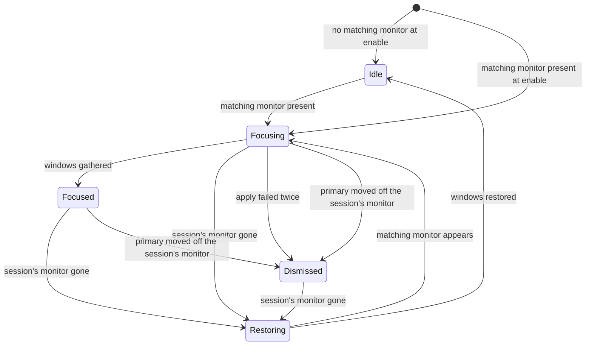

# Design

**Status:** design for the first release; the code that implements it is being written.

The extension is a five-state machine inside `gnome-shell`, driven by the monitor check (see
[States](#states)). The reasons behind its decisions are recorded in the
[architecture decision records](architecture/decisions/).

## Where it runs

The extension is code inside the `gnome-shell` process, loaded by the Shell's extension system.
Everything it reads and changes is on the same machine:

- **Monitor changes** (input): the Shell's `Main.layoutManager` emits `monitors-changed` whenever
  a monitor appears, disappears or is reconfigured. GNOME Desktop Sharing adds an RDP client's
  monitor this way: a virtual monitor with vendor `MetaVendor` and product
  `Virtual remote monitor`, sized to the client window.
- **The monitor list** (input): `global.backend.get_monitor_manager().get_monitors()` gives each
  monitor's vendor, product, serial and connector; `get_monitor_for_connector()` maps a connector to
  the monitor index that the window API uses. The extension reads it to record, gather and restore
  windows.
- **Window placement** (input): `global.display.list_all_windows()` and each `Meta.Window`'s frame,
  monitor, workspace and maximized, fullscreen and minimized state. The extension handles only
  _normal windows_ (`Meta.WindowType.NORMAL`, not skipped from the taskbar).
- **Display configuration** (input and output): Mutter's `org.gnome.Mutter.DisplayConfig` D-Bus
  interface, called asynchronously from inside the Shell. `GetCurrentState` reads the layout, and
  the monitor check takes from it the matching monitors and which of them is primary;
  `ApplyMonitorsConfig` with the _temporary_ method changes which monitor is primary. A temporary
  configuration is never written to `~/.config/monitors.xml`.
- **Window moves** (output): `Meta.Window` methods (`move_to_monitor`, `change_workspace_by_index`,
  `stick`, `unstick`, `move_resize_frame`, `set_maximize_flags`, `unmaximize`, `make_fullscreen`,
  `unmake_fullscreen`, `minimize`, `unminimize`).

## States

Monitor changes arrive in bursts (a connecting client produces several), so the extension acts on
`monitors-changed` only after a quiet period set by the debounce setting. What it does then is the
_monitor check_, which also runs at `enable()`, on unlock and once a restore finishes. A check due
while the quiet period after a monitor change is running waits for it, and one check answers both. A
check whose reply comes after another monitor change, or after an unlock, is dropped, and the check
that follows answers instead. A check that fails is logged and changes nothing: if it ran at
`enable()`, or after a monitor change or an unlock, the placement record takes no new placements
until a later check; if the session's monitor went, the windows are restored only at that later
check.

_The extension's lifecycle for one session, including a reconnect during restore; a client whose
monitor was already present when the session ended gets a new session from Idle. Arrows labelled
with a monitor condition follow the monitor check; the others follow the extension's own work
finishing or failing._

**Idle.** No session. Usually no virtual monitor is present; right after a restore one may be, until
the monitor check that follows. The extension keeps the placement record (next section) up to date;
it records new placements only in Idle, and only while the screen is unlocked (see [Lifecycle inside
the Shell](#lifecycle-inside-the-shell)). On entering Idle it rebuilds the record from the current
placement of every normal window, as `enable()` does; if the screen is locked then, the rebuild is
deferred to unlock.

**Focusing.** A virtual monitor matches the vendor and product. If several do, the extension takes
those that appeared at the latest monitor check that added any and, among them, the one with the
lowest monitor serial. To know which monitors are new, the extension notes for each virtual monitor,
by connector and serial, the monitor check at which it first appeared, and forgets the entry when
the monitor goes; monitors present at `enable()` count as appearing at that first check, and
monitors that appeared while the screen was locked count as appearing at the unlock check. The
chosen monitor is the session's own until it goes
([ADR-0002](architecture/decisions/0002-match-the-virtual-monitor.md)). The extension:

1. takes the placement record as the session's snapshot, unless it already holds one from a
   session that is still being restored;
2. reads `GetCurrentState` and sends the same layout back with only the logical monitor of the
   session's monitor marked primary, using the state serial from that reply and the temporary
   method; if that monitor is primary already, it sends nothing. A failed apply is retried once,
   from a fresh `GetCurrentState`, at the next monitor check or one debounce period after the
   failure, whichever comes first
   ([ADR-0003](architecture/decisions/0003-apply-the-primary-temporarily.md));
3. if it applied, waits, at most one debounce period after the apply, for the monitor check that
   follows the resulting `monitors-changed`, so that work areas and the top bar have moved; if that
   check finds the primary already off the session's monitor, the extension goes to Dismissed and
   gathers nothing; if no check comes by then, it gathers anyway;
4. moves each snapshotted normal window (all workspaces or only the current one, per a setting) to
   the session's monitor with `move_to_monitor`. Maximized, fullscreen and minimized windows are
   moved too and keep their state.

Settings can turn off making the monitor primary (step 2), gathering (step 4) and the restore when
the session ends. By default all three are on, gathering takes windows from all workspaces, the
debounce period is 500 ms and the settle period 250 ms; a hidden debug-logging setting, off by
default, adds a journal line for each state change, apply and gather. Each step reads its setting
when it runs, so a change during a session takes effect at the next step that uses it and moves
nothing by itself.

Mutter does not remember a temporary configuration, so the extension applies it again on every
connect. The virtual monitor's serial changes with each session. Matching ignores it; the
extension uses it to order monitors that arrived together and, with the connector, to recognise
the session's own monitor.

**Focused.** The remote user works on the virtual monitor, which now holds the top bar,
notifications and the gathered windows. Windows opened during the session are left where GNOME
places them and are not restored later. A client resizing its window is expected to change the
virtual monitor's mode (a change not yet observed), which is not a reason to act, and neither is any
other change to positions, scales or modes. If the primary moves off the session's monitor while it
is still present, the extension treats it as a deliberate rearrangement and moves to Dismissed; this
holds only if the session's monitor was primary when gathering began, which it usually is not when
the setting that makes it primary is off. A virtual monitor that arrives in Focusing, Focused or
Dismissed is ignored. The session ends only when its own monitor goes, even if other virtual
monitors remain.

**Dismissed.** The session's monitor is present but the extension no longer acts on it: the apply
failed twice, or the user took the primary back. It changes neither windows nor the layout while the
client stays connected, even if the primary returns to the session's monitor.

**Restoring.** The client disconnected. Mutter removes the virtual monitor and returns to the
previous layout by itself; it parks the gathered windows on the remaining primary monitor. Unless
the restore setting is off, the extension then puts back each window it gathered, and only those,
whatever the remote user did to them, with one exception for the workspace, below. For each window
it leaves fullscreen if the window is fullscreen now and was not in the snapshot, then restores the
monitor and the workspace. It leaves the maximized state if the window is maximized in a direction
the snapshot does not have, sets the frame rectangle (stored relative to its monitor) unless the
snapshot has it maximized in both directions, and maximizes it in the snapshot's directions; then it
restores the fullscreen and minimized states. With `org.gnome.mutter workspaces-only-on-primary` on
(the default), Mutter keeps every window on a monitor other than the primary on all workspaces; the
snapshot records such a window as having no workspace of its own, and the restore sets none: Mutter
keeps the window on all workspaces while it is off the primary monitor and puts it on the active
workspace if it lands on the primary. A window whose snapshot gives it a workspace but whose
original monitor is no longer primary stays on all workspaces too, as Mutter keeps it there, and
loses that workspace. The extension finds a window's original monitor by vendor, product and
serial, and by connector only to choose among monitors that share all three; if none of them has
the stored connector, the monitor counts as gone
([ADR-0004](architecture/decisions/0004-snapshot-and-restore-windows.md)). If the session ended
before any windows were gathered, nothing moves. Windows gathered before a reconnect still count as
gathered, even if the reconnected session goes to Dismissed. Windows that closed during the session
are skipped, and so are windows whose original monitor no longer exists, which are left as they are;
the extension logs each window whose monitor is gone, once. A window whose move throws is logged
while the others still move: when gathering it stays where it is, and when restoring it can be left
part-way back. A window that could not be gathered is not restored. If the client reconnects before
this finishes (a matching monitor appears during Restoring, or at the very monitor check that found
the session's monitor gone), the extension goes back to Focusing with the same snapshot, so the
windows still return to where they were before the first connect. A virtual monitor that was already
present before the check that found the session's monitor gone does not count as a reconnect: once
the restore finishes, the extension enters Idle, rebuilding the placement record from the restored
windows, and runs the monitor check right away, so another client still connected gets a session of
its own. If the screen is locked, both the rebuild and the check wait for unlock.

## The placement record

The snapshot has to describe the layout from _before_ the virtual monitor arrived, but by the
time the extension sees `monitors-changed`, Mutter may already have moved windows as part of the
same monitor change. The extension therefore keeps a continuous record of where each normal
window last _settled_:

- it listens to each window's position, size, workspace, maximized, fullscreen and minimized
  changes, to window creation and removal, to changes that make a window normal or not, and to
  workspaces being removed or reordered, which changes the workspace index of windows that did not
  move;
- a change is committed to the record only after the window has been still for a short period
  (the settle setting);
- the first `monitors-changed` of a burst discards every change not yet committed and stops commits
  until the monitor check has run, so moves Mutter makes during a monitor change, however late in
  the burst they come, cannot reach the record before the check decides whether a session starts;
- if the check leaves the extension in Idle, each window that changed during the burst, or whose
  change was discarded, is read again once it has been still for the settle period, so the record
  follows a dock, an undock or any other monitor change that starts no session;
- locking the screen in Idle works like a burst that lasts until the unlock check: changes not yet
  committed are discarded, nothing is committed while the screen is locked, and if the unlock check
  leaves the extension in Idle, each window that changed in the meantime, or whose change was
  discarded, is read again once it has been still for the settle period.

A window that closes, or stops being a normal window, leaves the record at once, also in other
states and while the screen is locked: dropping it records no placement.

A window moved by the user within the settle period before a client connects is restored to its
previous position; that is the cost of the rule. If the client connects while the screen is locked,
the same holds for a window moved within the settle period before the screen locked.

## Lifecycle inside the Shell

`enable()` connects the signals, creates the D-Bus proxy asynchronously and builds the first
placement record; nothing happens at import time. If a matching monitor is already present (the
extension was enabled, or the user logged in, with a client connected), it goes straight to Focusing
and takes the placement record it has just built as the snapshot. That record shows the layout after
the virtual monitor arrived, including any moves Mutter made then, so a disconnect restores windows
to where they were at `enable()`. `disable()` disconnects every signal and removes every timeout.
During a session it first puts the gathered windows back as Restoring does, synchronously, even with
the restore setting off, and drops the snapshot (a window whose original monitor is gone stays on
the session's monitor until the client disconnects); it sends no display configuration, so the
temporary primary stays until the client disconnects, and it cancels every D-Bus call still in
flight: the proxy being created, a monitor check and an apply
([ADR-0004](architecture/decisions/0004-snapshot-and-restore-windows.md), part 5). A window put back
on the monitor that was primary before the session is then on a monitor that is not primary. With
`workspaces-only-on-primary` on, Mutter keeps it on all workspaces while the client stays connected,
so it loses its workspace. In the test VMs (GNOME Shell 49.10 and 50.5) such windows stayed on all
workspaces after the client disconnected too: Mutter did not re-evaluate a window that did not move,
so it keeps that state until it moves onto the primary monitor from another or the setting changes.

The extension runs in the `user` and `unlock-dialog` session modes, so locking the screen does not
disable it ([ADR-0005](architecture/decisions/0005-keep-the-session-through-the-lock-screen.md)).
This matters only where the RDP session itself survives the lock: stock GNOME 49 and 50 end it when
the screen locks, so there a lock is a disconnect and the windows are restored at unlock. At login
the Shell enables extensions that run in more session modes first, so a lock after login leaves this
one running. If the extension was enabled during the session (turned on, installed or reloaded), the
Shell can still disable and re-enable it when the screen locks: with each extension it disables for
the lock screen, it also disables and re-enables every extension enabled after that one, as it does
whenever an extension is turned off. After the unlock that follows, the extension comes before the
extensions that list only `user` again. A `disable()` caused by the extension order puts the
gathered windows back behind the lock, and the `enable()` after it gathers them again at unlock,
so the remote user's arrangement is lost; the extension accepts that rather than keep a session
past `disable()` (ADR-0005, part 1 and its amendments).

When the screen locks, a pending monitor check is dropped; while it is locked the extension starts
no new work: gathered windows stay where they are, the snapshot is kept and the placement record
takes no new placements (a window that closes, or stops being a normal window, still leaves it; see
[The placement record](#the-placement-record) for what happens at unlock). A `disable()` while the
screen is locked still puts the gathered windows back, as above. A restore under way finishes; so
does Focusing work already under way while the session's monitor is present, including a pending
retry of the apply and gathering the windows.

Monitor changes while the screen is locked still lead to monitor checks, which start no new work and
only follow the session's own monitor: they note no new monitors. In Focusing, such a check lets a
gather that waits for the apply's layout change go ahead or, if the primary has already left the
session's monitor by then, ends Focusing in Dismissed instead. If it finds the session's monitor
gone, it cancels the apply, retry or gather still pending, since there is nothing left to work on,
and leaves the session to the unlock check.

An `enable()` while the screen is locked waits and runs in full at unlock. Otherwise, on unlock the
extension first carries out a deferred rebuild of the placement record, if one is waiting, and then
runs the monitor check. A client that disconnected while the screen was locked has its windows
restored right away, unless a matching monitor also appeared meanwhile: the unlock check counts that
as a reconnect and goes back to Focusing with the same snapshot
([ADR-0002](architecture/decisions/0002-match-the-virtual-monitor.md), part 3 and its consequences).
If the session's monitor, found gone at a check while the screen was locked, is present again at the
unlock check, Focusing starts the apply over. A client that connected meanwhile goes to Focusing
with the placements recorded before the screen locked, or with the record rebuilt at unlock if a
restore finished while the screen was locked. The rebuilt record, like one built at `enable()`,
already includes any moves Mutter made when the client connected.
