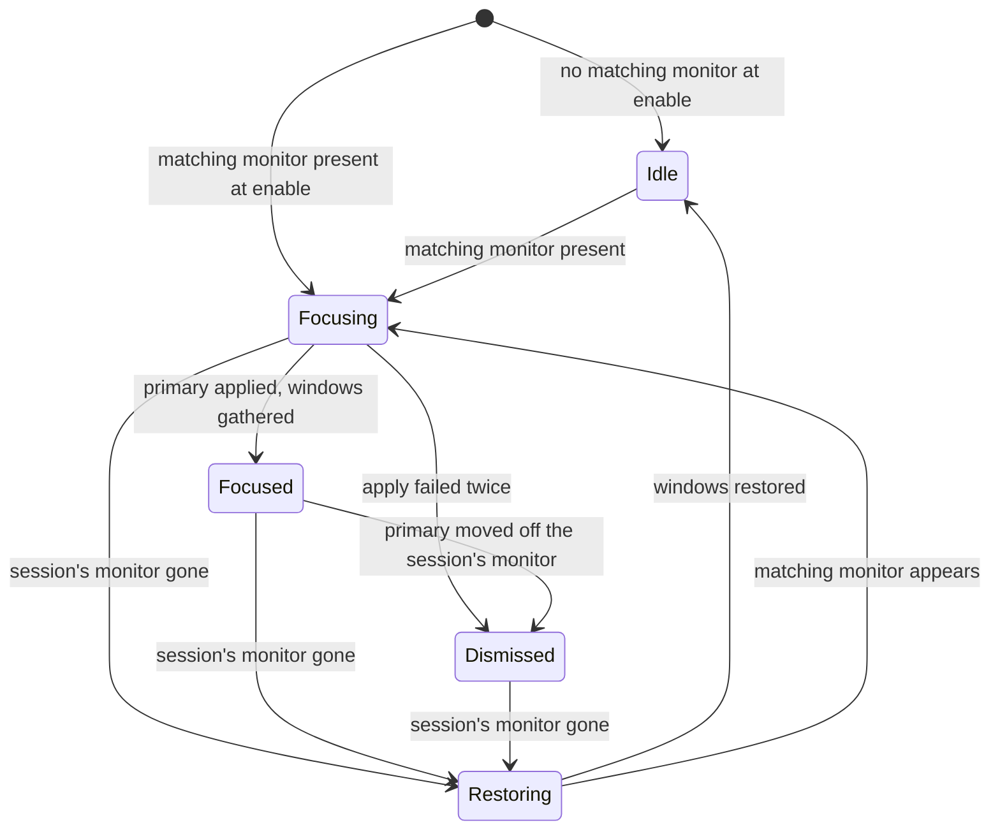

# Design

**Status:** design for the first release; the code that implements it is being written.

The extension is a five-state machine inside `gnome-shell`, driven by the monitor check (see
[States](#states)). The reasons behind its decisions are recorded in the
[architecture decision records](architecture/decisions/).

## Where it runs

The extension is code inside the `gnome-shell` process, loaded by the Shell's extension system.
Everything it reads and changes is on the same machine:

- **Monitor changes** (input): the Shell's `Main.layoutManager` emits `monitors-changed` whenever
  a monitor appears, disappears or is reconfigured. GNOME Desktop Sharing adds an RDP client's
  monitor this way: a virtual monitor with vendor `MetaVendor` and product
  `Virtual remote monitor`, sized to the client window.
- **The monitor list** (input): `global.backend.get_monitor_manager().get_monitors()` gives each
  monitor's vendor, product, serial and connector; `get_monitor_for_connector()` maps a connector to
  the monitor index that the window API uses.
- **Window placement** (input): `global.display.list_all_windows()` and each `Meta.Window`'s frame,
  monitor, workspace and maximized, fullscreen and minimized state. The extension handles only
  _normal windows_ (`Meta.WindowType.NORMAL`, not skipped from the taskbar).
- **Display configuration** (input and output): Mutter's `org.gnome.Mutter.DisplayConfig` D-Bus
  interface, called asynchronously from inside the Shell. `GetCurrentState` reads the layout;
  `ApplyMonitorsConfig` with the _temporary_ method changes which monitor is primary. A temporary
  configuration is never written to `~/.config/monitors.xml`.
- **Window moves** (output): `Meta.Window` methods (`move_to_monitor`, `change_workspace`,
  `move_resize_frame`, `set_maximize_flags` with `maximize`, `set_unmaximize_flags` with
  `unmaximize`, `make_fullscreen`, `unmake_fullscreen`, `minimize`, `unminimize`).

## States

Monitor changes arrive in bursts (a connecting client produces several), so the extension acts on
`monitors-changed` only after a quiet period set by the debounce setting. What it does then is the
_monitor check_, which also runs at `enable()`, on unlock and once a restore finishes.

_The extension's lifecycle for one session, including a reconnect during restore; a client whose
monitor was already present when the session ended gets a new session from Idle. Arrows labelled
with a monitor condition follow the monitor check; the others follow the extension's own work
finishing or failing._

**Idle.** No session. Usually no virtual monitor is present; right after a restore one may be, until
the monitor check that follows. The extension keeps the placement record (next section) up to date;
it does so only in Idle, and only while the screen is unlocked (see [Lifecycle inside the
Shell](#lifecycle-inside-the-shell)). On entering Idle it rebuilds the record from the current
placement of every normal window, as `enable()` does; if the screen is locked then, the rebuild is
deferred to unlock.

**Focusing.** A virtual monitor matches the vendor and product. If several do, the extension takes
those that appeared at the latest monitor check that added any and, among them, the one with the
lowest monitor serial. To know which monitors are new, the extension notes for each virtual monitor,
by connector and serial, the monitor check at which it first appeared, and forgets the entry when
the monitor goes; monitors present at `enable()` count as appearing at that first check, and
monitors that appeared while the screen was locked count as appearing at the unlock check. The
chosen monitor is the session's own until it goes
([ADR-0002](architecture/decisions/0002-match-the-virtual-monitor.md)). The extension:

1. takes the placement record as the session's snapshot, unless it already holds one from a
   session that is still being restored;
2. reads `GetCurrentState` and sends the same layout back with only the logical monitor of the
   session's monitor marked primary, using the state serial from that reply and the temporary
   method; if that monitor is primary already, it sends nothing. A failed apply is retried once,
   from a fresh `GetCurrentState`, at the next monitor check or one debounce period after the
   failure, whichever comes first
   ([ADR-0003](architecture/decisions/0003-apply-the-primary-temporarily.md));
3. if it applied, waits for the resulting `monitors-changed`, so that work areas and the top bar
   have moved;
4. moves each snapshotted normal window (all workspaces or only the current one, per a setting) to
   the session's monitor with `move_to_monitor`. Maximized, fullscreen and minimized windows are
   moved too and keep their state.

Mutter does not remember a temporary configuration, so the extension applies it again on every
connect. The virtual monitor's serial changes with each session. Matching ignores it; the
extension uses it to order monitors that arrived together and, with the connector, to recognise
the session's own monitor.

**Focused.** The remote user works on the virtual monitor, which now holds the top bar,
notifications and the gathered windows. Windows opened during the session are left where GNOME
places them and are not restored later. A client resizing its window changes the virtual monitor's
mode, which is not a reason to act, and neither is any other change to positions, scales or modes.
If the primary moves off the session's monitor while it is still present, the extension treats it as
a deliberate rearrangement and moves to Dismissed. A virtual monitor that arrives in Focusing,
Focused or Dismissed is ignored. The session ends only when its own monitor goes, even if other
virtual monitors remain.

**Dismissed.** The session's monitor is present but the extension no longer acts on it: the apply
failed twice, or the user took the primary back. It changes neither windows nor the layout while the
client stays connected, even if the primary returns to the session's monitor.

**Restoring.** The client disconnected. Mutter removes the virtual monitor and returns to the
previous layout by itself; it parks the gathered windows on the remaining primary monitor. The
extension then puts back each window it gathered, and only those, whatever the remote user did to
them. For each window it leaves fullscreen if the window is fullscreen now and was not in the
snapshot, then restores the workspace, the monitor, the maximized state, the frame rectangle (stored
relative to its monitor) for windows that were not maximized, and the fullscreen and minimized
states. It finds a window's original monitor by vendor, product and serial, and by connector only to
choose among monitors that share all three
([ADR-0004](architecture/decisions/0004-snapshot-and-restore-windows.md)). If the session ended
before any apply succeeded, nothing was gathered and nothing moves. Windows that closed during the
session are skipped, and so are windows whose original monitor no longer exists, which are left as
they are; the extension logs each window whose monitor is gone, once. If the client reconnects
before this finishes (a matching monitor appears during Restoring, or at the very monitor check that
found the session's monitor gone), the extension goes back to Focusing with the same snapshot, so
the windows still return to where they were before the first connect. A virtual monitor that was
already present before the check that found the session's monitor gone does not count as a
reconnect: once the restore finishes, the extension enters Idle, rebuilding the placement record
from the restored windows, and runs the monitor check right away, so another client still connected
gets a session of its own. If the screen is locked, both the rebuild and the check wait for unlock.

## The placement record

The snapshot has to describe the layout from _before_ the virtual monitor arrived, but by the
time the extension sees `monitors-changed`, Mutter may already have moved windows as part of the
same monitor change. The extension therefore keeps a continuous record of where each normal
window last _settled_:

- it listens to each window's position, size, workspace, maximized, fullscreen and minimized
  changes, and to window creation and removal;
- a change is committed to the record only after the window has been still for a short period
  (the settle setting);
- the first `monitors-changed` of a burst discards every change not yet committed and stops commits
  until the monitor check has run, so moves Mutter makes during a monitor change never reach the
  record, however late in the burst they come.

A window moved by the user within the settle period before a client connects is restored to its
previous position; that is the cost of the rule.

## Lifecycle inside the Shell

`enable()` connects the signals, creates the D-Bus proxy asynchronously and builds the first
placement record; nothing happens at import time. If a matching monitor is already present (the
extension was enabled, or the user logged in, with a client connected), it goes straight to Focusing
and takes the placement record it has just built as the snapshot. That record shows the layout after
the virtual monitor arrived, including any moves Mutter made then, so a disconnect restores windows
to where they were at `enable()`. `disable()` disconnects every signal and removes every timeout.
During a session it first puts the gathered windows back as Restoring does, synchronously, and drops
the snapshot (a window whose original monitor is gone stays on the session's monitor until the
client disconnects); it sends no display configuration and cancels an apply still in flight, so the
temporary primary stays until the client disconnects
([ADR-0004](architecture/decisions/0004-snapshot-and-restore-windows.md), part 5).

The extension runs in the `user` and `unlock-dialog` session modes, so locking the screen does not
disable it. When the screen locks, a pending monitor check is dropped; while it is locked the
extension starts nothing: gathered windows stay where they are, the snapshot is kept and the
placement record is not updated. Focusing work already under way finishes, including a pending retry
of the apply and gathering the windows, and so does a restore. An `enable()` while the screen is
locked waits and runs in full at unlock. Otherwise, on unlock the extension first carries out a
deferred rebuild of the placement record, if one is waiting, and then runs the monitor check. A
client that disconnected while the screen was locked has its windows restored right away, unless a
matching monitor also appeared meanwhile: the unlock check counts that as a reconnect and goes back
to Focusing with the same snapshot
([ADR-0002](architecture/decisions/0002-match-the-virtual-monitor.md), part 3 and its consequences).
A client that connected meanwhile goes to Focusing with the record as it stood when the screen
locked, or as rebuilt at unlock if a restore finished while the screen was locked. The rebuilt
record, like one built at `enable()`, already includes any moves Mutter made when the client
connected.
